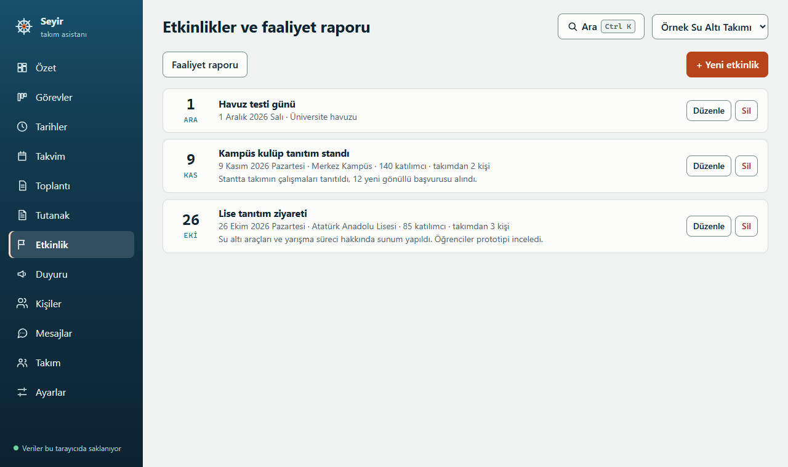
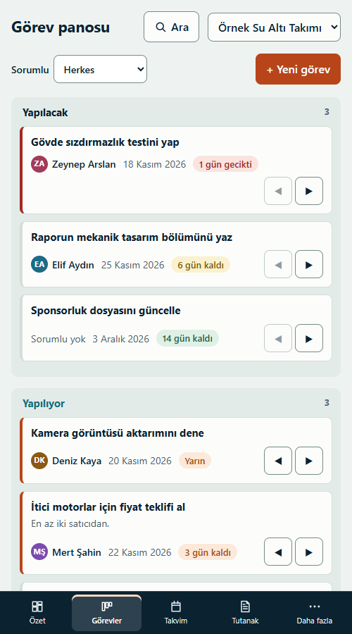

# Takım Asistanı

Öğrenci takımları için görev, son tarih, toplantı tutanağı, etkinlik ve duyuru
asistanı. Düz HTML, CSS ve JavaScript — framework yok, derleme adımı yok,
bağımlılık yok.

**[Türkçe](#türkçe)** · **[English](#english)**


---

## Türkçe

### Ne işe yarar?

Yarışmalara hazırlanan öğrenci takımlarında aynı sorunlar tekrar eder:
toplantıda alınan kararlar unutulur, görevin kimde olduğu karışır, rapor ve
izin tarihleri son anda hatırlanır, dönem sonunda "bu dönem ne yaptık?"
sorusuna cevap aranır. Takım Asistanı bunları tek sayfada toplar.

### Özellikler

| | |
|---|---|
| **Takım ve üyeler** | Takım oluştur, üye ekle, rol ver (kaptan / üye). Birden fazla takım. |
| **Görev panosu** | Yapılacak / Yapılıyor / Bitti; sorumlu, bitiş tarihi, sorumluya göre süzme. |
| **Son tarih takibi** | Rapor, izin, etkinlik tarihleri için geri sayım; yaklaşan ve geciken vurgulanır. |
| **Takvim** | Son tarihler, toplantılar ve etkinlikler tek ayda. |
| **Toplantı tutanağı** | Tarih, yer, katılanlar, gündem, kararlar, görevler. Karardan tek tıkla görev. Yazdırılabilir / PDF. |
| **Resmî tutanak (PDF / Word)** | Kulübün resmî toplantı tutanağı: A4, çerçeveli, imza bölümlü. Formu elle doldur, notlarını yapıştır ya da .txt / .docx yükle; numara kendiliğinden artar, devreden kararlar önceki tutanaklardan atfıyla seçilir. PDF ve Word (.docx) çıktısı. |
| **Yoklama** | Toplantı ve etkinliklere kim katıldı; üye bazında katılım yüzdesi. |
| **Etkinlik ve faaliyet raporu** | Etkinlik kaydı; seçilen tarih aralığı için yazdırılabilir rapor taslağı. |
| **Duyuru şablonu** | Toplantı daveti, özeti ya da hatırlatma için WhatsApp'a yapıştırılmaya hazır metin (yapay zekâ yok, düz şablon). |
| **Yedekleme** | Bütün veriyi JSON olarak indir, başka cihazda geri yükle. |
| **Koyu / açık tema** | Cihaza uyar ya da elle seçilir. |
| **Ana ekrana eklenebilir** | Telefonda uygulama gibi açılır; internet yokken de çalışır (PWA). |

Kişisel veri olarak yalnızca **ad ve rol** tutulur. Ücretli servis kullanılmaz.

| Takvim | Görev panosu (koyu tema) |
|---|---|
|  |  |

| Etkinlikler | Dar ekran |
|---|---|
|  |  |

<!-- Görüntüler örnek veriyle, araçla alındı (index.html?ornek=1).
     Toplantı tutanağının ve kendi takımının görüntüsünü eklemek istersen
     docs/ekran/ klasörüne koyup bu tabloya satır ekle. -->

### Nasıl çalıştırılır?

**En kolay yol:** `index.html` dosyasına çift tıkla.

Ana ekrana ekleme ve çevrimdışı çalışma için yerel sunucuyla aç:

```bash
python -m http.server 8765
```

Sonra tarayıcıda `http://localhost:8765`.

İlk açılışta **Örnek veriyle dene** düğmesi hayali bir takım yükler. Adresin
sonuna `?ornek=1` eklersen (ör. `index.html?ornek=1`) örnek takım kendiliğinden
yüklenir; demo bağlantısı olarak paylaşmak için kullanışlıdır.

Veriler varsayılan olarak **tarayıcının localStorage alanında** durur: yalnızca
o tarayıcıda görünür. Arada bir **Ayarlar → Yedeği indir** ile yedek al.

### Testler

```bash
npm test
```

146 test; Node 18+ yeterli, paket kurmak gerekmez. Tarih hesabı, takvim,
yoklama, rapor, duyuru şablonları, iki veri deposu, giriş, yedekleme, resmî
tutanak (numara, atıf, not ayrıştırma, Word okuma/yazma), renk kontrastı ve
PWA dosya listesi denetlenir.

```bash
npm run test:pdf
```

Uydurma bir örnek tutanağı gerçekten PDF'e çevirir (bilgisayarda kurulu Edge
ya da Chrome ile) ve üç şeyi denetler: sayfa sayısı, Türkçe harfler, serif
yazı tipi. Çıktı: `testler/cikti/ornek-tutanak.pdf`.

### Mimari (kısaca)

```
EKRANLAR  js/ekranlar/*.js     ne gösterilecek, tıklanınca ne olacak
   │
   ├─► ARAYÜZ  js/arayuz.js    form penceresi, bildirim, tıklama eylemleri
   ├─► MANTIK  js/mantik.js    saf fonksiyonlar (tarih, takvim, yoklama, şablon)
   │
   └─► VERİ KATMANI  js/veri.js    listele · oku · ekle · guncelle · sil
            ├─ yerelDepoOlustur     → localStorage
            └─ supabaseDepoOlustur  → Supabase (REST + fetch)
```

1. **Veri tek arayüzün arkasında.** Ekranlar veriye beş fonksiyonla ulaşır;
   arkasında localStorage mı Supabase mi olduğunu bilmezler.
2. **Mantık ekrandan ayrı ve saf;** tarayıcı açmadan test edilir.
3. **Değişince yeniden çiz;** ekranla veri hiçbir zaman uyumsuz kalmaz.

Ayrıntı: [ARCHITECTURE.md](ARCHITECTURE.md)

### Ekip olarak ortak kullanım (isteğe bağlı)

Veriyi buluta taşıyıp ekibin aynı veriyi görmesi için Supabase kurulabilir.
Giriş (e-posta + şifre) gerekir; her hesap yalnızca üyesi olduğu takımın
verisini görür. Bu kural veritabanında uygulanır.

- Kurulum: [SUPABASE_KURULUM.md](SUPABASE_KURULUM.md)
- Yayına alma: [YAYIN.md](YAYIN.md)

> **Durum:** Supabase tarafı sahte sunucuyla test edildi; **gerçek bir Supabase
> projesiyle henüz denenmedi.** İlk kurulumda rehberdeki "Güvenliği dene"
> adımı mutlaka uygulanmalı.

### Belgeler

| Dosya | İçerik |
|---|---|
| [ARCHITECTURE.md](ARCHITECTURE.md) | Mimari özet: klasör yapısı, veri akışı, kararlar ve nedenleri |
| [RAPOR.md](RAPOR.md) | v1 kod denetimi: bulunan 29 sorun ve durumları |
| [PROGRESS.md](PROGRESS.md) | Aşama aşama ne yapıldı, neden öyle yapıldı |
| [QUESTIONS.md](QUESTIONS.md) | Yapılan varsayımlar ve karar bekleyen konular |
| [SUPABASE_KURULUM.md](SUPABASE_KURULUM.md) | Supabase kurulum rehberi |
| [YAYIN.md](YAYIN.md) | Netlify'da yayına alma |
| [MULAKAT.md](MULAKAT.md) | Proje hakkında sorulabilecek 20 soru |

### Bilinen sınırlar

- Supabase kipi gerçek bir projeyle denenmedi (yukarıdaki not).
- Otomatik arayüz testi yok; arayüz tarayıcıda elle denendi.
- Aynı kaydı iki kişi aynı anda düzenlerse son kaydeden kazanır.
- Takım içinde yetki ayrımı yok: her üye her şeyi yapabilir.
- PDF, tarayıcının "Yazdır → PDF olarak kaydet" özelliğiyle alınır.

### ROTA İSAS ekibinde kullanıldı

<!-- Ekip uygulamayı gerçekten kullandıktan sonra doldurulacak:
     ne zaman, kaç kişi, hangi toplantılarda, ne işe yaradı, ne eksik kaldı.
     Varsa bir ekran görüntüsü (kişisel bilgiler görünmeyecek şekilde). -->

_Bu bölüm henüz doldurulmadı._

### Nasıl yapıldı?

Bu proje bir yapay zekâ kodlama asistanıyla (Claude) birlikte geliştirildi;
commit geçmişinde `Co-Authored-By` satırlarıyla görünür.

---

## English

A small team assistant for student engineering teams (built with a Teknofest
underwater-vehicle team in mind): tasks, deadlines, meeting minutes, events and
announcements in one page. The interface is in Turkish.

Plain HTML, CSS and JavaScript — no framework, no build step, no dependencies.

### Features

- **Team & members** — roles (captain / member), multiple teams.
- **Task board** — To do / Doing / Done, assignee, due date, per-person filter.
- **Deadline tracking** — countdowns; upcoming and overdue items are highlighted.
- **Calendar** — deadlines, meetings and events in one month view.
- **Meeting minutes** — agenda, decisions, tasks; turn a decision into a task in one click; printable / PDF.
- **Official minutes (PDF / Word)** — the club's formal A4 minutes with page frame, numbered articles and a signature block. Fill the form, paste free-text notes, or upload a .txt / .docx; numbering auto-increments and carried-over decisions are picked from earlier minutes with citations. Exports to PDF (browser print engine) and .docx (hand-written ZIP + WordprocessingML, no library).
- **Attendance** — who attended each meeting or event; attendance rate per member.
- **Events & activity report** — event log and a printable draft report for a chosen date range.
- **Announcement templates** — ready-to-paste WhatsApp text (plain templates, no AI).
- **Backup** — export / import all data as JSON.
- **Light / dark theme**, **installable PWA** with offline support.

Only **name and role** are stored about people.

### Running it

Double-click `index.html`, or serve the folder (needed for install / offline):

```bash
python -m http.server 8765
```

Data lives in the browser's **localStorage** by default. Append `?ornek=1` to
the URL to load a fictional demo team automatically.

### Tests

```bash
npm test
```

146 tests with Node's built-in test runner (Node 18+, nothing to install).
`npm run test:pdf` renders a fictional sample of the official minutes to PDF
with the locally installed Edge/Chrome and checks page count, Turkish
characters and the serif font.

### Architecture

- `js/veri.js` — the **data layer**: one interface (`listele`, `oku`, `ekle`,
  `guncelle`, `sil`), two implementations (localStorage and Supabase REST via
  `fetch`). A contract test runs the same scenario against both. The backend
  is chosen by the `VERI_KATMANI` environment variable.
- `js/mantik.js` — pure functions (dates, calendar grid, attendance, report, templates).
- `js/ekranlar/*.js` — one file per screen; each registers itself and the menu is built from that registry.
- `js/oturum.js` — Supabase Auth over REST (sign in, token refresh), used only in Supabase mode.
- `supabase/schema.sql` — tables and row-level security: a user sees only the teams they belong to.
- After every change the current screen re-reads its data and re-renders.

Details (in Turkish): [ARCHITECTURE.md](ARCHITECTURE.md). A self-audit of v1 with
29 findings is in [RAPOR.md](RAPOR.md).

### Optional: shared data with Supabase, and deployment

See [SUPABASE_KURULUM.md](SUPABASE_KURULUM.md) and [YAYIN.md](YAYIN.md) (Turkish).
`netlify.toml` includes security headers with a Content Security Policy.

> **Status:** the Supabase backend and auth are covered by tests against a fake
> server and the security headers were exercised locally, but the app has
> **not yet been run against a live Supabase project or deployed to Netlify.**

### Known limitations

No automated UI tests; last write wins on concurrent edits; no per-role
permissions inside a team.

### Used by the ROTA İSAS team

_To be filled in once the team has actually used it._

### How it was built

Developed together with an AI coding assistant (Claude); see the
`Co-Authored-By` lines in the commit history.
