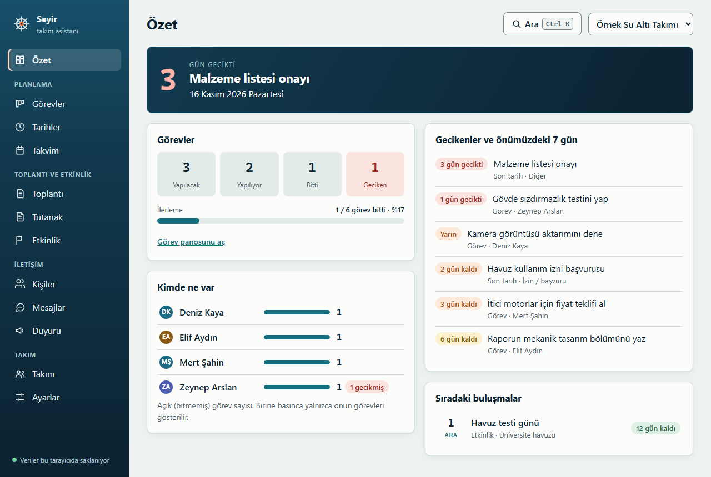
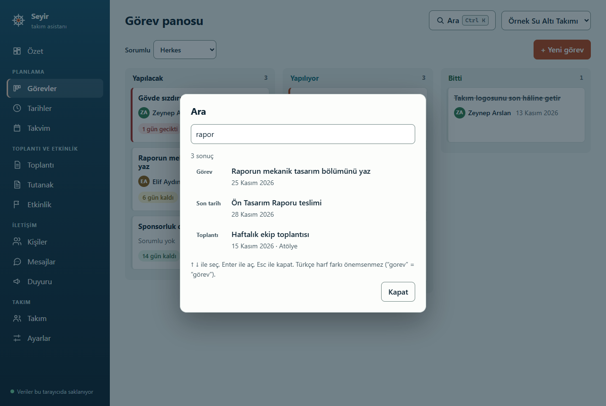
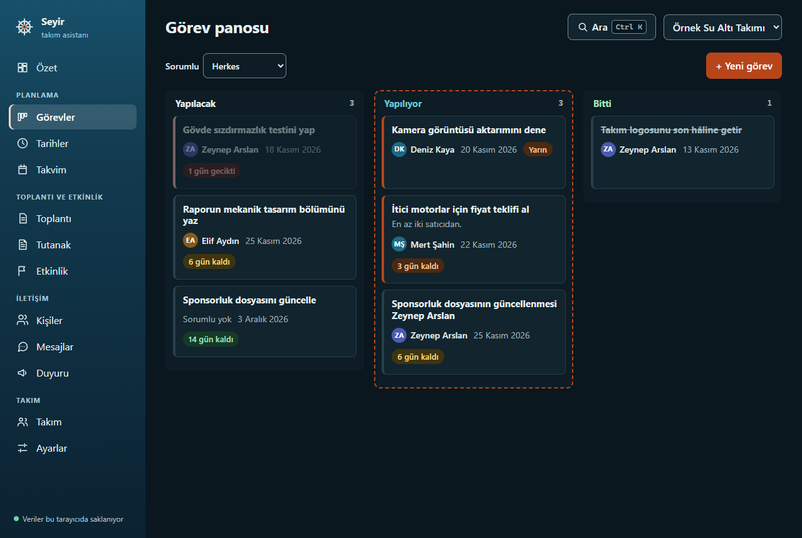
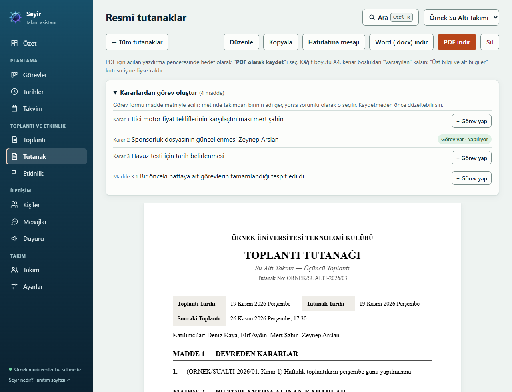
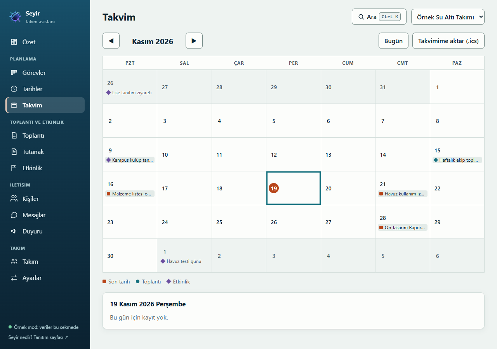
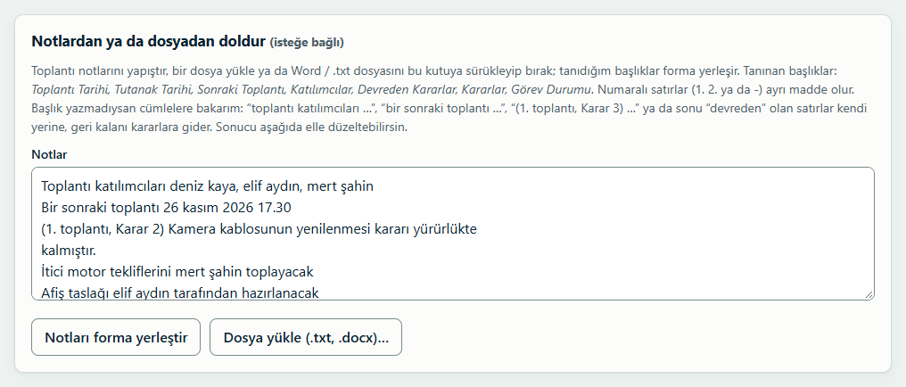
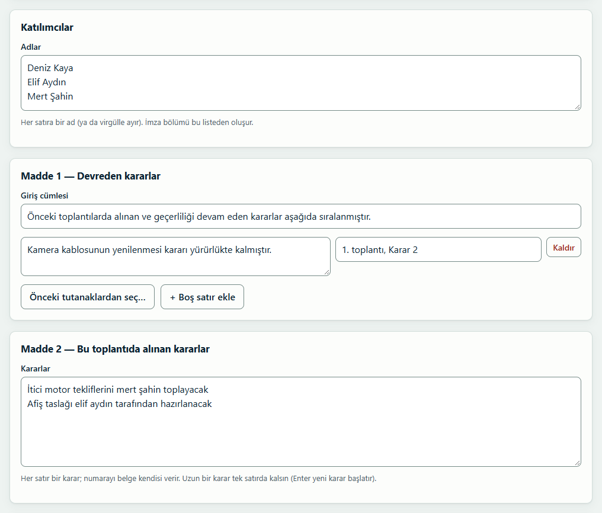

# Seyir — Team Assistant for Student Teams

[](https://github.com/dvlp-omer/seyir/actions/workflows/testler.yml)


**Seyir — Öğrenci Takımları İçin Takım Asistanı**

Öğrenci takımları için görev, son tarih, toplantı tutanağı, etkinlik, kişi
rehberi ve WhatsApp mesajı asistanı. Düz HTML, CSS ve JavaScript — framework yok, derleme adımı yok,
bağımlılık yok.

**[Türkçe](#türkçe)** · **[English](#english)**

**Tanıtım / Landing:** <https://seyir-takim.vercel.app> · **Uygulama / App:** <https://seyir-takim.vercel.app/uygulama>

**Canlı / Live:** uygulama Supabase kipinde çalışır;
hesap açmak davetlidir (sign-up is invite-only).



---

## Türkçe

### Ne işe yarar?

Yarışmalara hazırlanan öğrenci takımlarında aynı sorunlar tekrar eder:
toplantıda alınan kararlar unutulur, görevin kimde olduğu karışır, rapor ve
izin tarihleri son anda hatırlanır, dönem sonunda "bu dönem ne yaptık?"
sorusuna cevap aranır. Seyir bunları tek sayfada toplar.

Ad nereden geliyor? *Seyir*, denizcilikte bir teknenin rotasında ilerleyişidir
(seyir defteri, seyir hâli). Proje bir sualtı aracı takımı için başladı; logodaki pusula
yıldızı yönü, küre ve yörünge şeridi de takımın etrafında döndüğü işi anlatır.

### Özellikler

| | |
|---|---|
| **Takım ve üyeler** | Takım oluştur, üye ekle, rol ver (kaptan / üye). Birden fazla takım. |
| **Görev panosu** | Yapılacak / Yapılıyor / Bitti; kartları sürükleyerek taşı (ya da ◀ ▶). Sorumlu, bitiş tarihi, sorumluya göre süzme. |
| **Son tarih takibi** | Rapor, izin, etkinlik tarihleri için geri sayım; yaklaşan ve geciken vurgulanır. |
| **Takvim** | Son tarihler, toplantılar ve etkinlikler tek ayda. **Takvimime aktar (.ics)**: Google Takvim ya da telefon takvimine tek dosyayla. |
| **Toplantı tutanağı** | Tarih, yer, katılanlar, gündem, kararlar, görevler. Karardan tek tıkla görev. Yazdırılabilir / PDF. |
| **Resmî tutanak (PDF / Word)** | Kulübün resmî toplantı tutanağı: A4, çerçeveli, imza bölümlü. Formu elle doldur, notlarını yapıştır ya da .txt / .docx yükle; Word dosyasını sürükleyip bırakmak da olur; başlıksız serbest notlar da cümlelerine bakılarak yerleşir. Numara kendiliğinden artar, devreden kararlar önceki tutanaklardan atfıyla seçilir. Kararlardan tek tıkla görev (metinde adı geçen üye sorumlu seçilir). PDF ve Word (.docx) çıktısı. |
| **Yoklama** | Toplantı ve etkinliklere kim katıldı; üye bazında katılım yüzdesi. |
| **Etkinlik ve faaliyet raporu** | Etkinlik kaydı; seçilen tarih aralığı için yazdırılabilir rapor taslağı. |
| **Kişiler** | Rehber: ad, hitap adı, telefon, etiket (başvuran, kabul edildi, üye…), not. CSV dosyası, Excel'den yapıştırma ya da "kabul mesajları" HTML dosyasından önizlemeli içe aktarma. Numaralar tek biçime çevrilir (`0532…`, `+90…`, `0090…` → `90…`); geçersiz ve yinelenenler gösterilir. |
| **WhatsApp mesajları** | Kaydedilebilir şablonlar (`{ad}`, `{tarih}`, `{saat}`, `{yer}`, `{link}`); kişileri süzüp seç, her biri için mesajı hazır açan **WhatsApp'ta aç** düğmesi, gönderildi işareti ve sayaç (12/72); her gönderim ayrı kayıt. Gruba duyuru: kopyala ya da WhatsApp'ta paylaş. Resmî tutanaktan tek tıkla toplantı hatırlatması. Otomatik toplu gönderim **yok** (WhatsApp resmî olarak desteklemez). |
| **Duyuru şablonu** | Toplantı daveti, özeti ya da hatırlatma için WhatsApp'a yapıştırılmaya hazır metin (yapay zekâ yok, düz şablon). |
| **Arama ve kısayollar** | **Ctrl+K** ya da **/** ile bütün kayıtlarda ara (Türkçe harf farkı önemsenmez); **Ctrl+S** kaydeder, **?** kısayol listesini açar. |
| **Yarım kalan form kaybolmaz** | Form yazılırken taslak tarayıcıya saklanır; sayfa yenilense de geri gelir. |
| **Yedekleme** | Bütün veriyi JSON olarak indir, başka cihazda geri yükle. |
| **Koyu / açık tema** | Cihaza uyar ya da elle seçilir. |
| **Ana ekrana eklenebilir** | Telefonda uygulama gibi açılır; internet yokken de çalışır (PWA). |

**Kişisel veri:** kadroda yalnızca ad ve rol; rehberde ayrıca telefon. Ortak
kullanımda (Supabase) giriş zorunlu, hesap açmak yalnızca davetle, her kayıt
yalnızca kendi takımına görünür. Örnek veri, testler ve ekran görüntülerinde
gerçek kişi yok (numaralar kullanılmayan `0500 000 00 xx` aralığında; bir test
depoda gerçek görünen numara arar). Ücretli servis kullanılmaz.

| Genel arama (Ctrl+K) | Görev panosu: kart sürüklenirken (koyu tema) |
|---|---|
|  |  |

| Resmî tutanak: kararlardan görev | Takvim ve .ics aktarımı |
|---|---|
|  |  |

| Başlıksız serbest notlar… | …forma kendiliğinden yerleşir |
|---|---|
|  |  |

| Etkinlikler | Dar ekran |
|---|---|
|  |  |

<!-- Görüntüler uydurma örnek veriyle (uygulama.html?ornek=1, yerel mod), penceresiz
     Chrome ile alındı. Kişiler ve kurum adları uydurmadır. -->

### Nasıl çalıştırılır?

**En kolay yol:** `uygulama.html` dosyasına çift tıkla.

Ana ekrana ekleme ve çevrimdışı çalışma için yerel sunucuyla aç:

```bash
python -m http.server 8765
```

Sonra tarayıcıda `http://localhost:8765/uygulama.html`.

İlk açılışta **Örnek veriyle dene** düğmesi hayali bir takım yükler. Adresin
sonuna `?ornek=1` eklersen (ör. `uygulama.html?ornek=1`) örnek takım kendiliğinden
yüklenir; demo bağlantısı olarak paylaşmak için kullanışlıdır.

Veriler varsayılan olarak **tarayıcının localStorage alanında** durur: yalnızca
o tarayıcıda görünür. Arada bir **Ayarlar → Yedeği indir** ile yedek al.

### Testler

```bash
npm test
```

241 test; Node 22+ yeterli, paket kurmak gerekmez. Her gönderimde GitHub Actions da çalıştırır. Tarih hesabı, takvim,
yoklama, rapor, duyuru şablonları, iki veri deposu (aynı sözleşme testleri),
giriş ve davetli kayıt, yedekleme, resmî tutanak (numara, atıf, not
ayrıştırma, Word okuma/yazma), kişiler (telefon biçimi, CSV, HTML içe
aktarma, şablon, wa.me bağlantısı), veritabanı şemasının güvenliği (her
tabloda RLS ve ziyaretçi yasağı), depoda kişisel veri olmaması, renk
kontrastı ve PWA dosya listesi denetlenir.

```bash
npm run test:pdf
```

Uydurma bir örnek tutanağı gerçekten PDF'e çevirir (bilgisayarda kurulu Edge
ya da Chrome ile) ve üç şeyi denetler: sayfa sayısı, Türkçe harfler, serif
yazı tipi. Çıktı: `testler/cikti/ornek-tutanak.pdf`.

### Mimari (kısaca)

```
EKRANLAR  js/ekranlar/*.js     ne gösterilecek, tıklanınca ne olacak
   │
   ├─► ARAYÜZ  js/arayuz.js    form penceresi, bildirim, tıklama eylemleri
   ├─► MANTIK  js/mantik.js    saf fonksiyonlar (tarih, takvim, yoklama, şablon)
   │
   └─► VERİ KATMANI  js/veri.js    listele · oku · ekle · guncelle · sil
            ├─ yerelDepoOlustur     → localStorage
            └─ supabaseDepoOlustur  → Supabase (REST + fetch)
```

1. **Veri tek arayüzün arkasında.** Ekranlar veriye beş fonksiyonla ulaşır;
   arkasında localStorage mı Supabase mi olduğunu bilmezler.
2. **Mantık ekrandan ayrı ve saf;** tarayıcı açmadan test edilir.
3. **Değişince yeniden çiz;** ekranla veri hiçbir zaman uyumsuz kalmaz.

Ayrıntı: [ARCHITECTURE.md](ARCHITECTURE.md)

### Ekip olarak ortak kullanım (isteğe bağlı)

Veriyi buluta taşıyıp ekibin aynı veriyi görmesi için Supabase kurulabilir.
Giriş (e-posta + şifre) gerekir; her hesap yalnızca üyesi olduğu takımın
verisini görür; giriş yapmayan hiçbir şey göremez. **Kayıt herkese açık
değildir:** ilk hesap yönetici olur, diğerleri yalnızca yöneticinin davet
listesine eklediği e-postayla hesap açabilir. Bu kuralların hepsi
veritabanında uygulanır (`supabase/schema.sql`).

Giriş ekranında "Beni hatırla" (işaretsizse tarayıcı kapanınca çıkış yapılır),
"Şifremi unuttum" (e-postaya tek kullanımlık sıfırlama bağlantısı) ve şifreyi
göster düğmesi var; şifre Ayarlar'dan da değiştirilebilir.

- Kurulum: [SUPABASE_KURULUM.md](SUPABASE_KURULUM.md)
- Yayına alma (Netlify ya da Vercel): [YAYIN.md](YAYIN.md)

> **Durum:** Canlı sürüm gerçek bir Supabase projesine bağlı ve güvenliği orada
> denendi: giriş yapmadan yapılan veri istekleri reddediliyor, davet
> listesinde olmayan e-postayla hesap açılamıyor. Kendi kurulumunda
> rehberdeki "Güvenliği dene" adımını uygula.

### Belgeler

| Dosya | İçerik |
|---|---|
| [ARCHITECTURE.md](ARCHITECTURE.md) | Mimari özet: klasör yapısı, veri akışı, kararlar ve nedenleri |
| [RAPOR.md](RAPOR.md) | v1 kod denetimi: bulunan 29 sorun ve durumları |
| [SUPABASE_KURULUM.md](SUPABASE_KURULUM.md) | Supabase kurulum rehberi |
| [YAYIN.md](YAYIN.md) | Netlify ya da Vercel'de yayına alma |

### Bilinen sınırlar

- Otomatik arayüz testi yok; arayüz tarayıcıda elle denendi.
- Aynı kaydı iki kişi aynı anda düzenlerse ikinci kaydeden uyarılır ("Yine de
  kaydet" ile üzerine yazabilir); değişiklikleri alan alan birleştirme yok.
- Takım içinde yetki ayrımı yok: her üye her şeyi yapabilir ("yönetici"nin
  tek ayrıcalığı davet listesi).
- PDF, tarayıcının "Yazdır → PDF olarak kaydet" özelliğiyle alınır.
- WhatsApp mesajları tek tek gönderilir (her kişi için bir tık); "gönderildi"
  işareti tıklamayla konur, gerçekten gönderildiğini doğrulamaz.
- Yalnızca Türkiye cep numaraları kabul edilir.

### ROTA İSAS ekibinde kullanıldı

<!-- Ekip uygulamayı gerçekten kullandıktan sonra doldurulacak:
     ne zaman, kaç kişi, hangi toplantılarda, ne işe yaradı, ne eksik kaldı.
     Varsa bir ekran görüntüsü (kişisel bilgiler görünmeyecek şekilde). -->

_Bu bölüm henüz doldurulmadı._

### Nasıl yapıldı?

Bu proje bir yapay zekâ kodlama asistanıyla (Claude) birlikte geliştirildi;
commit geçmişinde `Co-Authored-By` satırlarıyla görünür.

---

## English

**Seyir** is a small team assistant for student engineering teams (built with a
Teknofest underwater-vehicle team in mind): tasks, deadlines, meeting minutes,
events and announcements in one page. The interface is in Turkish. The name
means "voyage / passage" in Turkish nautical language; the logo is a ship's wheel.

Plain HTML, CSS and JavaScript — no framework, no build step, no dependencies.

### Features

- **Team & members** — roles (captain / member), multiple teams.
- **Task board** — To do / Doing / Done with drag and drop (or ◀ ▶ buttons for keyboard and touch), assignee, due date, per-person filter.
- **Deadline tracking** — countdowns; upcoming and overdue items are highlighted.
- **Calendar** — deadlines, meetings and events in one month view; export upcoming items as an `.ics` file (RFC 5545, hand-written) for Google Calendar or a phone.
- **Meeting minutes** — agenda, decisions, tasks; turn a decision into a task in one click; printable / PDF.
- **Official minutes (PDF / Word)** — the club's formal A4 minutes with page frame, numbered articles and a signature block. Fill the form, paste free-text notes, or upload a .txt / .docx; numbering auto-increments and carried-over decisions are picked from earlier minutes with citations. Drag and drop a Word file; free-form notes without headings are sorted line by line with rules (no AI, nothing leaves the browser). Turn any decision into a task, with the assignee guessed from a member name in the text. Exports to PDF (browser print engine) and .docx (hand-written ZIP + WordprocessingML, no library).
- **Attendance** — who attended each meeting or event; attendance rate per member.
- **Events & activity report** — event log and a printable draft report for a chosen date range.
- **Contacts** — name, salutation, phone, tag, note. Import from CSV, pasted spreadsheet rows, or the "acceptance messages" HTML page (the array is parsed as data, never executed). Phone numbers are normalised to `90XXXXXXXXXX`; invalid and duplicate rows are listed before anything is saved.
- **WhatsApp messages** — saved templates with `{ad}`, `{tarih}`, `{saat}`, `{yer}`, `{link}`; filter and pick contacts, then a per-person **Open in WhatsApp** (`wa.me`) button with a sent marker and a 12/72 progress counter; every send list is stored. Group announcements via copy or `wa.me/?text=`. One-click meeting reminder from an official minutes record. No automated bulk sending (WhatsApp does not officially support it).
- **Announcement templates** — ready-to-paste WhatsApp text (plain templates, no AI).
- **Search & shortcuts** — Ctrl+K or / searches every record (Turkish-letter-insensitive); Ctrl+S saves the open form; ? lists shortcuts.
- **Drafts** — unsaved forms are kept in the browser and restored after a reload.
- **Backup** — export / import all data as JSON.
- **Light / dark theme**, **installable PWA** with offline support.

Team roster: name and role only. The contact list also stores phone numbers;
in shared (Supabase) mode sign-in is required, sign-up is **invite-only** (the
first account becomes admin), and row-level security limits every row to its
team. Demo data, tests and screenshots contain no real people (a test scans
the repo for real-looking phone numbers).

| Search (Ctrl+K) | Official minutes: decisions → tasks |
|---|---|
|  |  |

| Free-form notes… | …sorted into the form by rules |
|---|---|
|  |  |

### Running it

Double-click `uygulama.html`, or serve the folder (needed for install / offline):

```bash
python -m http.server 8765
```

Data lives in the browser's **localStorage** by default. Append `?ornek=1` to
the URL to load a fictional demo team automatically.

### Tests

```bash
npm test
```

241 tests with Node's built-in test runner (Node 22+, nothing to install; run on every push by GitHub Actions),
including a static check of `schema.sql` (RLS enabled, a policy and no
anonymous access on every table) and a scan for personal data in the repo.
`npm run test:pdf` renders a fictional sample of the official minutes to PDF
with the locally installed Edge/Chrome and checks page count, Turkish
characters and the serif font.

### Architecture

- `js/veri.js` — the **data layer**: one interface (`listele`, `oku`, `ekle`,
  `guncelle`, `sil`), two implementations (localStorage and Supabase REST via
  `fetch`). A contract test runs the same scenario against both. The backend
  is chosen by the `VERI_KATMANI` environment variable.
- `js/mantik.js` — pure functions (dates, calendar grid, attendance, report, templates).
- `js/ekranlar/*.js` — one file per screen; each registers itself and the menu is built from that registry.
- `js/oturum.js` — Supabase Auth over REST (sign in, token refresh, "remember me", password reset and change), used only in Supabase mode.
- `supabase/schema.sql` — tables and row-level security: a user sees only the teams they belong to; triggers on `auth.users` make sign-up invite-only.
- `js/kisiler.js` — pure logic for contacts and WhatsApp (phone normalisation, CSV/HTML import, templates, `wa.me` links, send-list progress).
- After every change the current screen re-reads its data and re-renders.

Details (in Turkish): [ARCHITECTURE.md](ARCHITECTURE.md). A self-audit of v1 with
29 findings is in [RAPOR.md](RAPOR.md).

### Optional: shared data with Supabase, and deployment

See [SUPABASE_KURULUM.md](SUPABASE_KURULUM.md) and [YAYIN.md](YAYIN.md) (Turkish).
`netlify.toml` and `vercel.json` send the same security headers with a Content
Security Policy (a test keeps them in sync).

> **Status:** deployed on Vercel (<https://seyir-takim.vercel.app>) against a
> live Supabase project. Verified there: anonymous REST requests are denied,
> sign-up with an uninvited e-mail is rejected, security headers are served.

### Known limitations

No automated UI tests; concurrent edits are detected with a per-row version
number (the second writer is warned, no field-level merge); no per-role
permissions inside a team (the admin role only manages the invite list);
WhatsApp messages are opened one by one and "sent" is marked on click.

### Used by the ROTA İSAS team

_To be filled in once the team has actually used it._

### How it was built

Developed together with an AI coding assistant (Claude); see the
`Co-Authored-By` lines in the commit history.
